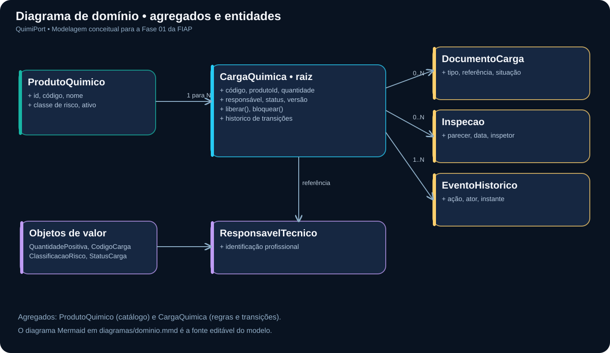
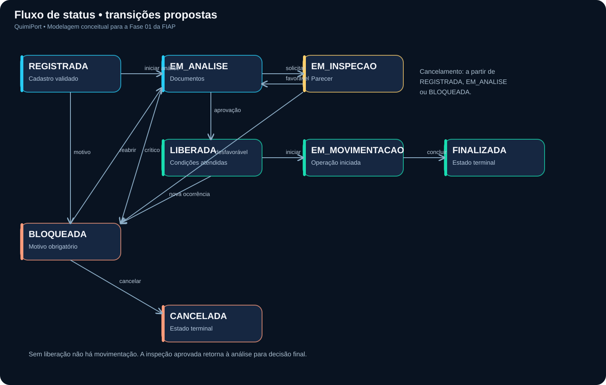

# QuimiPort — pré-conferência de cargas perigosas em operações portuárias

**Tech Challenge · Pós-Tech Full Stack Development · FIAP · Fase 01**  
**Estudante:** Leandro Dias · **Contexto de estudo:** operações portuárias inspiradas no Porto de Santos

> **Pergunta do projeto:** antes de liberar uma carga perigosa para movimentação, como reunir evidências da conferência documental, identificar pendências e deixar rastreável quem tomou cada decisão?

A ideia é resolver **um problema operacional delimitado**: a conferência interna de requisitos e o acompanhamento de pendências de uma carga perigosa. O QuimiPort **não pretende substituir o Porto Sem Papel**, emitir licenças, homologar procedimentos de segurança ou automatizar a autorização legal. Nesta fase, o resultado é **um projeto técnico e arquitetural**, conforme o enunciado. Não é um software pronto para uso real.

## Por que esse problema merece estudo?

O serviço federal **Porto Sem Papel** descreve uma Declaração de Carga Perigosa, enquanto o **Porto de Santos** publica normas próprias para movimentação de mercadorias classificadas pelo IMDG. Isso demonstra a existência de exigências e atores distintos. **Nossa hipótese**, ainda sem entrevistas com operadores, é que uma visão unificada das pendências internas e do histórico de decisão pode reduzir retrabalho e ambiguidades de acompanhamento. Não afirmamos ter medido esse problema no porto.

**Fontes primárias consultadas:** [Porto de Santos — normas e regulamentos](https://www.portodesantos.com.br/informacoes-operacionais/normas-e-regulamentos/), [Serviço Porto Sem Papel](https://www.gov.br/pt-br/servicos/obter-autorizacao-para-movimentacao-de-cargas-perigosas-no-porto-sem-papel-psp?id=12324&origem=servico), [ANTAQ — cargas perigosas](https://www.gov.br/antaq/pt-br/assuntos/sustentabilidade/cargas-perigosas-1) e [IMO — IMDG Code](https://www.imo.org/en/publications/pages/imdg%20code.aspx). Veja [o que cada fonte sustenta — e o que ela não sustenta](docs/17-fontes-e-evidencias.md).

## Um caso para testar o raciocínio

Um operador registra a carga **CQ-2026-001** (dados fictícios). A conferência interna identifica uma referência documental pendente. A carga permanece **EM_ANALISE** e a tentativa de liberação é rejeitada. O analista registra a pendência; após regularização e validação pela autoridade competente na operação, um responsável habilitado poderia analisar uma nova solicitação de liberação.

**Essa sequência é uma proposta de fluxo de software**, não a descrição de um caso real do Porto de Santos. [Veja a ficha do caso, alternativas e critérios de aceite](docs/16-estudo-de-caso.md).

## Como a solução foi pensada — sem esconder as decisões

| Pergunta | Escolha inicial | Por quê? | Onde conferir |
|---|---|---|---|
| Qual informação governa a liberação? | Agregado `CargaQuimica` | Proteger documentos, inspeção, status e histórico na mesma decisão | [DDD](docs/02-ddd.md) |
| Por que não liberar apenas com uma flag `valido`? | Política documental por contexto | Documentos exigidos variam conforme a operação | [Regras](docs/04-regras-de-negocio.md) |
| Como evitar estados impossíveis? | Máquina de estados explícita | Bloqueada/cancelada não podem seguir normalmente | [Diagrama de status](diagramas/status.mmd) |
| Por que monólito modular e não microsserviços? | Menos acoplamento operacional inicial | Requisitos ainda estão sendo descobertos | [ADRs](docs/09-decisoes-e-roadmap.md) |
| Como comprovar o desenho? | Testes planejados e cenários de erro | Fazer as regras poderem ser contestadas e verificadas | [Qualidade](docs/07-plano-de-qualidade.md) |

## Diagramas: fontes editáveis e como foram desenhados

Os diagramas não são imagens sem origem. Existem **fontes Mermaid** (`.mmd`), adequadas para revisão no [Mermaid Live Editor](https://mermaid.live/), e **fontes Graphviz** (`.dot`) utilizadas para gerar os SVGs ilustrativos.

| Artefato | Fonte editável | Imagem ampliável | Explicação do processo |
|---|---|---|---|
| Domínio e agregados — obrigatório | [Mermaid](diagramas/dominio.mmd) / [Graphviz](diagramas/dominio.dot) | [SVG](diagramas/dominio.svg) | [Como reproduzir](docs/18-como-construi-os-diagramas.md) |
| Fluxo de estados — obrigatório | [Mermaid](diagramas/status.mmd) / [Graphviz](diagramas/status.dot) | [SVG](diagramas/status.svg) | [Como reproduzir](docs/18-como-construi-os-diagramas.md) |
| Arquitetura — complementar | [Mermaid](diagramas/arquitetura.mmd) | [SVG](diagramas/arquitetura.svg) | [Como reproduzir](docs/18-como-construi-os-diagramas.md) |





## Caminho de leitura para o avaliador

**Comece aqui:** [Problema investigado](docs/16-estudo-de-caso.md) → [Fontes e evidências](docs/17-fontes-e-evidencias.md) → [Modelagem DDD](docs/02-ddd.md) → [Casos de uso](docs/03-casos-de-uso.md) → [Regras](docs/04-regras-de-negocio.md) → [Diagramas](docs/06-diagramas.md) → [Qualidade](docs/07-plano-de-qualidade.md) → [ADRs](docs/09-decisoes-e-roadmap.md).

**Materiais complementares:** [Contexto e atores](docs/01-contexto-e-domínio.md), [Arquitetura e pastas](docs/05-arquitetura.md), [JavaScript/TypeScript](docs/08-javascript-typescript.md), [Passo a passo dos diagramas](docs/18-como-construi-os-diagramas.md), [Plano de validação com profissionais](docs/19-validacao-pendente.md), [Diário de elaboração](docs/20-caderno-de-elaboracao.md), [Roteiro de 8 minutos](apresentacao/GUIA_VIDEO_CASO_REAL.md), [Matriz de aderência ao PDF](docs/15-matriz-de-aderencia-pdf.md), [Checklist final](docs/11-checklist-entrega.md).

## Estado real do trabalho e uso de IA

- **Concluído na proposta:** pesquisa documental com fontes públicas, definição de cenário fictício, modelagem inicial, diagramas e planejamento de qualidade.
- **Ainda não realizado:** entrevista com operadores, observação em terminal, homologação regulatória, implantação em porto, medição real de resultados, gravação/submissão do vídeo e confirmação de autorização para entrega individual.
- **Apoio de IA:** foi utilizado na redação, revisão, estruturação e prototipação dos documentos. As escolhas e justificativas precisam ser estudadas e validadas pelo estudante antes da entrega. [Caderno aberto de elaboração](docs/20-caderno-de-elaboracao.md) — não se apresentam atividades fictícias como pesquisa de campo.

O [aplicativo industrial experimental](docs/12-extensao-industrial-futura.md) fica fora do repositório de entrega desta fase, pois o enunciado pede **a proposta técnica**, não frontend/backend implantados.

## Conferência automática e pendências acadêmicas

```bash
python scripts/validar_entrega.py
```

Essa checagem procura arquivos, diagramas e links quebrados; **não prova autoria ou conformidade normativa**. A entrega exige link de Git e vídeo de 5 a 10 minutos; o prazo e a possibilidade de trabalho individual precisam ser confirmados no portal/coordenação da FIAP.
