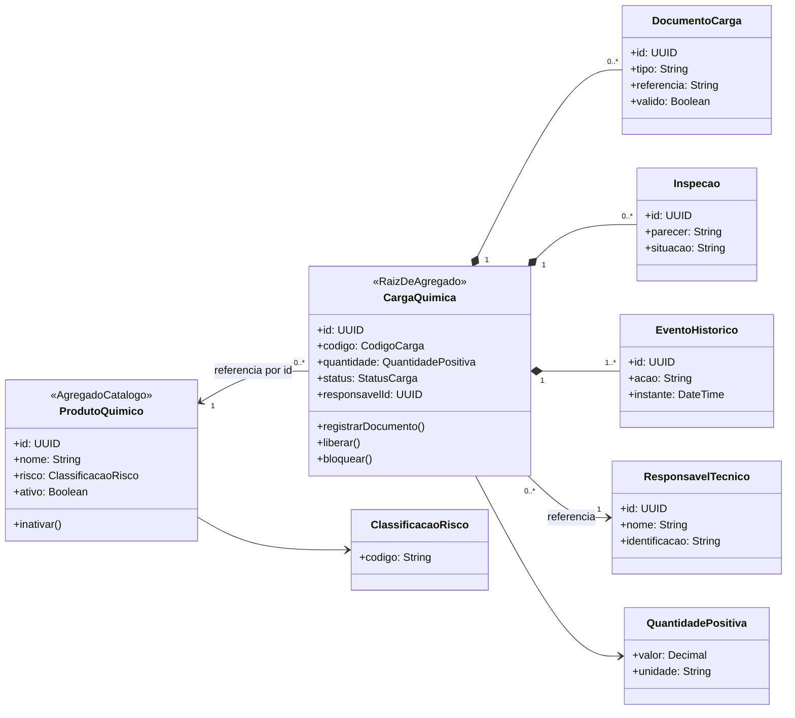
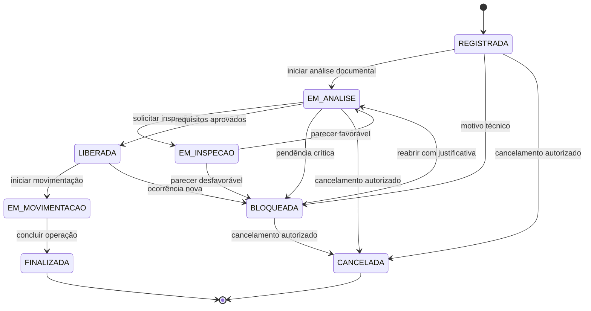
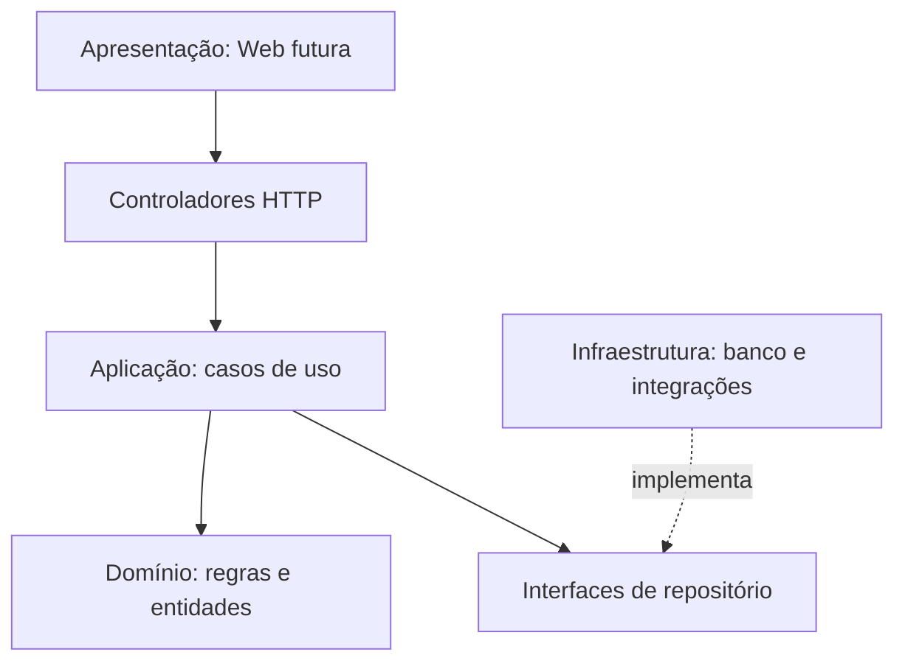

# 06 — Diagramas técnicos

Segundo o enunciado, o **Diagrama de Domínio** e o **Fluxo de Transição de Status da Carga** são obrigatórios. O diagrama de camadas é complementar.

## Diagrama 1 — Domínio e agregados (OBRIGATÓRIO)

**Agregados:** `ProdutoQuimico` (catálogo) e `CargaQuimica` (raiz de documentos, inspeções e histórico). `ResponsavelTecnico` é referência externa. Os VOs não têm identidade própria.

## Diagrama 2 — Transições de status (OBRIGATÓRIO)

**Regras:** não há atalho de `REGISTRADA` a `FINALIZADA`; `BLOQUEADA` não inicia movimentação; `CANCELADA` não libera. A volta de `BLOQUEADA` a `EM_ANALISE` **não significa liberação automática**. Estados e retornos são **proposta** a validar com requisitos mais detalhados.

## Diagrama 3 — Arquitetura em camadas (COMPLEMENTAR)

## Visualização imediata dos diagramas

Os arquivos `diagramas/dominio.svg` e `diagramas/status.svg` são versões vetoriais ampliáveis publicadas no GitHub. As fontes `.mmd` (Mermaid) e `.dot` (Graphviz) permitem conferir o modelo e gerar novas imagens. Veja o passo a passo em [Como os diagramas foram construídos](18-como-construi-os-diagramas.md).

> **Conferência:** as imagens e o Mermaid apresentam o mesmo modelo conceitual. Qualquer mudança de regra de status deve atualizar ambos para não gerar inconsistência entre código, diagrama e documentação.

## Processo e autoria verificável

Os SVGs foram gerados a partir de **Graphviz DOT** e não são apenas imagens decorativas. A modelagem também está descrita em Mermaid para permitir edição na web. O conjunto de decisões é proposto com apoio de IA; o estudante deve reproduzir e explicar os modelos antes da entrega. [Tutorial completo](18-como-construi-os-diagramas.md).

## Conferência de consistência da banca

1. `EM_INSPECAO` **não libera diretamente**. Com parecer favorável retorna a `EM_ANALISE` para decisão final.
2. O caso de uso de cancelamento só aceita os estados com seta explícita para `CANCELADA`.
3. Documento ausente mantém pendência em análise; apenas decisão de bloqueio gera `BLOQUEADA`.
4. Os dois diagramas obrigatórios contêm o modelo **proposto**, não um fluxo homologado para operação portuária.
5. A possibilidade de interromper movimentação em curso será analisada em fase futura e não é coberta pelo grafo inicial.
