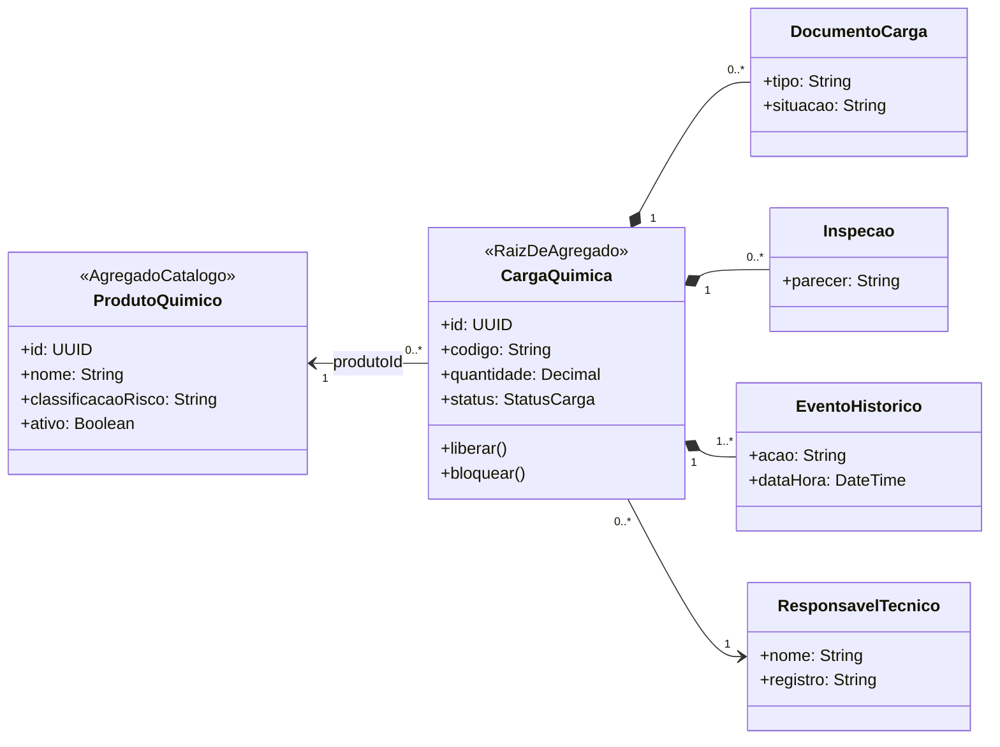
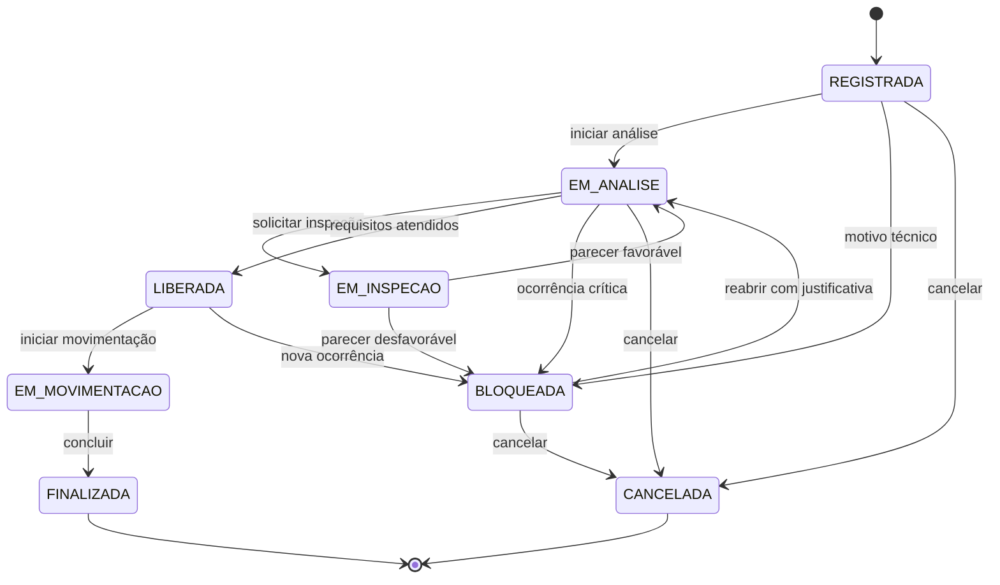
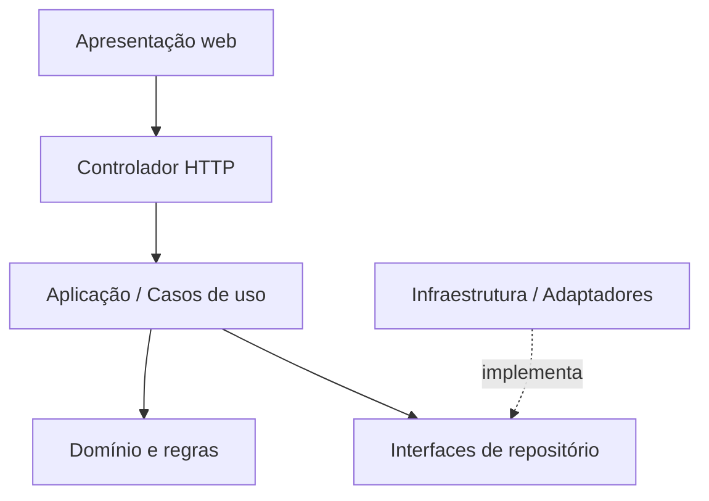

# 06 — Diagramas técnicos

O enunciado exige **Diagrama de Domínio (agregados/entidades)** e **Fluxo de Transição de Status da Carga**. A arquitetura em camadas é complementar.

## Diagrama obrigatório 1 — Domínio e agregados

**Modelo:** `ProdutoQuimico` é agregado independente de catálogo; `CargaQuimica` é raiz do agregado transacional; documentos, inspeções e eventos pertencem a uma carga; responsável é referência. `ClassificacaoRisco` e `QuantidadePositiva` são objetos de valor candidatos.

## Diagrama obrigatório 2 — Transições de status

**Nota de consistência:** parecer favorável não libera automaticamente; documento ausente cria pendência em análise. O cancelamento só parte dos estados indicados, e o tratamento de interrupção de movimentação em curso fica para levantamento futuro.

## Diagrama complementar — Camadas

**Fontes editáveis:** [domínio](../diagramas/dominio.mmd), [status](../diagramas/status.mmd) e [arquitetura](../diagramas/arquitetura.mmd). As visualizações representam um modelo **acadêmico**, não um fluxo regulamentar aprovado.
